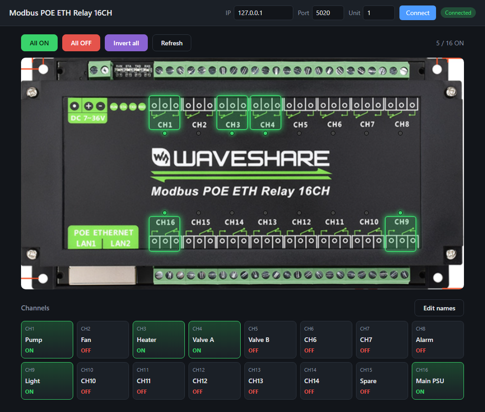
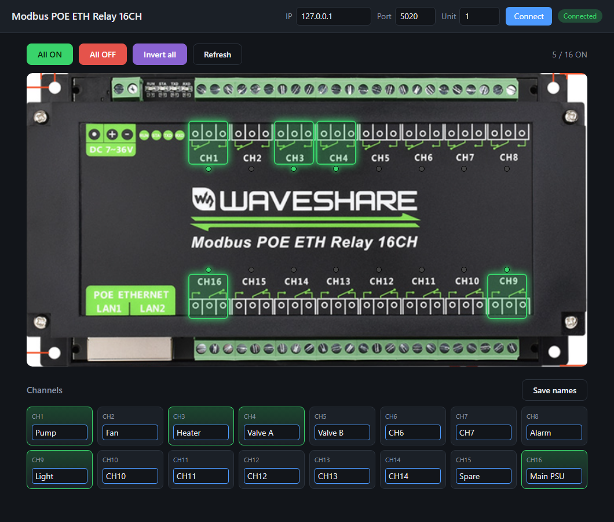

# Waveshare 16CH Relay – Web Control

A local web page to control the [Waveshare Modbus POE ETH Relay 16CH](https://www.waveshare.com/wiki/Modbus_POE_ETH_Relay_16CH) over Modbus TCP.



## Requirements

- Python 3.8+
- Flask

```
pip install -r requirements.txt
```

## Start

```
python app.py
```

The browser opens **http://127.0.0.1:5000** automatically. Keep the terminal open; press `Ctrl+C` to stop.
Use `python app.py --no-browser` to start without opening a browser.

## Connect to the relay board

1. In the top bar, enter the board's **IP**, **Port** (default `502`) and **Unit** (Modbus address, default `1`).
2. Click **Connect**. The badge turns green (**Connected**) and the page shows the real relay states.

The settings are saved and reused at the next start.

> The board must be in **Modbus TCP** mode (not *Modbus RTU over TCP*) – set this in the board's configuration tool.

## Control the relays

| Action | How |
| --- | --- |
| Switch one relay | Click the channel on the photo, or its card under **Channels** |
| All relays ON / OFF | **All ON** / **All OFF** |
| Invert every relay | **Invert all** |
| Re-read states from the board | **Refresh** |

An ON relay shows green on the photo and on its card. The counter at the top right shows how many relays are ON.

## Rename channels

1. Click **Edit names**.
2. Type the names (max 24 characters). An empty name goes back to `CHx`.
3. Click **Save names**.



## Test without the board

`sim_relay.py` simulates the relay board on your PC.

1. Terminal 1: `python sim_relay.py`
2. Terminal 2: `python app.py`
3. In the page, connect to IP `127.0.0.1`, port `5020`.

The simulator is not a web page: opening `http://127.0.0.1:5020` in a browser only shows a hint message.

## Troubleshooting

| Problem | Fix |
| --- | --- |
| Page does not load | Check that `app.py` is still running in its terminal, with the Python that has Flask installed. The address is `http://127.0.0.1:5000` (no trailing dot). |
| `No module named 'flask'` | Install Flask in the Python you run `app.py` with. |
| Badge shows **Offline** / `timed out` | Check the IP and port, and that the PC can ping the board. |
| `device exception code …` | Check the **Unit** number and that the board is in Modbus TCP mode. |

## Access from other PCs

By default the page is reachable from the host PC only. To open it to the network, change `host='127.0.0.1'` to `host='0.0.0.0'` at the end of `app.py`.
**There is no login**: anyone who can reach the page can switch the relays.

## Files

| File | Role |
| --- | --- |
| `app.py` | Web server (Flask) |
| `relay_client.py` | Modbus TCP communication with the board |
| `sim_relay.py` | Board simulator for testing |
| `static/` | Web page (HTML, CSS, JavaScript) |
| `ui/pic1.PNG` | Board photo used in the page |
| `config.json` | Saved IP, port, unit and channel names (created automatically) |
| `docs/` | Screenshots for this guide |
| `Modbus_POE_ETH_Relay_16CH_Code/` | Original Waveshare example code |
